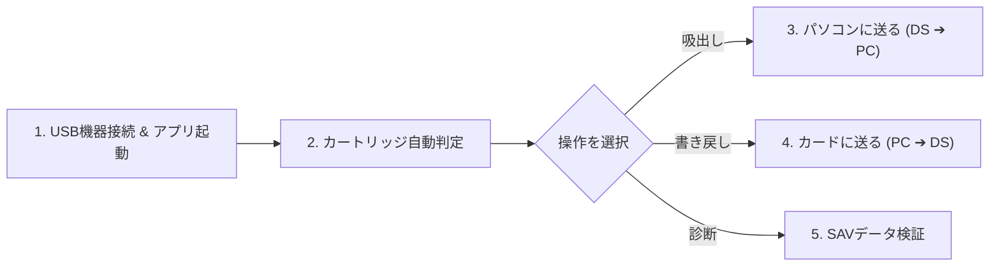

# 📖 GAMETECH NDS Adaptor（「セーブデータやりくり上手」）取扱説明書・動作マニュアル

---

## 1. 概要と対応環境

本アプリケーションは、XP時代のレトロ周辺機器 **GAMETECH 「セーブデータやりくり上手」 (VID: `0x4670`, PID: `0xE6E9`)** を、現代の **Windows 11 (64bit)** および **Ubuntu Linux** 環境でネイティブに動作させるための統合管理ソフトウェアです。

### 対応OS
- **Windows 11 (64bit) / Windows 10 (64bit)**
- **Ubuntu 26.04 LTS / 24.04 LTS / Debian Linux**

---

## 2. セットアップ・ドライバ設定手順

### 【A】 Windows 11 (64bit) 環境の場合

1. **機器を PC に接続**: GAMETECH NDS Adaptor を PC の USB ポートに接続します。
2. **Zadig の起動**: [Zadig](https://zadig.akeo.ie/) (`zadig-2.9.exe`) を起動します。
3. **デバイスの選択**:
   - メニュー `Options` ➔ `List All Devices` にチェックを入れます。
   - ドロップダウンから **`USB ID: 4670 E6E9`** のデバイスを選択します。
4. **WinUSB ドライバの割り当て**:
   - 矢印の右側で **`WinUSB`** (または `libusbK`) を選択し、**`Install Driver`** をクリックします。
5. **完了**: 「The driver was installed successfully.」と表示されれば完了です。

### 【B】 Ubuntu Linux 環境の場合

1. **必要なライブラリのインストール**:
   ```bash
   sudo apt update
   sudo apt install -y python3-pip python3-tk libusb-1.0-0-dev
   pip install pyusb
   ```
2. **権限付与（または root 実行）**:
   - USB デバイスアクセス権限のため、`sudo python3 Release/nds_save_manager_ubuntu.py` で実行します。

---

## 3. アプリケーションの起動方法

### Windows 11 の場合
- `Release/nds_save_manager.pyw` をダブルクリックするだけでそのまま GUI アプリが起動します。

### Ubuntu Linux の場合
- **GUI モード起動**:
  ```bash
  sudo python3 Release/nds_save_manager_ubuntu.py --gui
  ```
- **CLI (コマンドライン) モード起動**:
  - **吸出し（自動判定）**: `sudo python3 Release/nds_save_manager_ubuntu.py --dump my_save.sav`
  - **書き戻し（自動判定）**: `sudo python3 Release/nds_save_manager_ubuntu.py --restore my_save.sav`
  - **データ診断**: `python3 Release/nds_save_manager_ubuntu.py --verify my_save.sav`
  - *(※ 手動で容量を指定したい場合のみ `--size 64KB` 等のフラグを付与可能です)*

---

## 4. セーブデータの読み書き基本操作



### ① カートリッジ自動判定
1. NDS カートリッジをアダプタにセットします。
2. **`カートリッジ自動判定 (0x9C 0xA5)`** ボタンを押します。
3. 接続されたカートリッジの容量（例: `64 KB (512Kbit - DQ9等)`）が自動判定され、コンボボックスにセットされます。

### ② パソコンに送る (DS ➔ PC 吸出し)
1. **`パソコンに送る (DS ➔ PC 吸出し)`** ボタンを押します。
2. 保存先のファイル名（例: `my_game_backup.sav`）を指定します。
3. 進捗バーが 100% に到達したら完了です。下部ログ画面に先頭 32 バイトの生ヘッダー（HEX & ASCII）および検出タイトル文字列が表示されます。

### ③ カードに送る (PC ➔ DS 書き戻し)
1. **`カードに送る (PC ➔ DS 書き戻し)`** ボタンを押します。
2. 書き戻したい `.sav` または `.nsd` ファイルを選択します。
3. 確認ダイアログで「はい」を選択すると、カートリッジへ書き戻しが行われます。

### ④ SAVデータ検証（バイナリ診断）
1. **`SAVデータ検証`** ボタンを押し、診断したいファイルを選択します。
2. ファイルサイズ、MD5 ハッシュ値、データ保持領域割合、および先頭ヘッダー情報（HEX, ASCII, 抽出タイトル文字列）を汎用的に表示・診断します。

---

## 5. トラブルシューティング

> [!TIP]
> **「接続状態 : OFF (未検出)」と表示される場合**
> - USB ケーブルがしっかり奥まで接続されているかご確認ください。
> - Windows の場合、Zadig で `WinUSB` が適用されているか再確認してください。
> - Linux の場合、`sudo` 権限で実行されているかご確認ください。

> [!WARNING]
> **吸い出したデータの先頭が `FF FF FF FF...` になっている場合**
> - カートリッジの金属端子の接触不良が原因です。端子を清潔な布や接点復活剤等で清掃し、アダプタに奥までしっかり挿し直してください。
