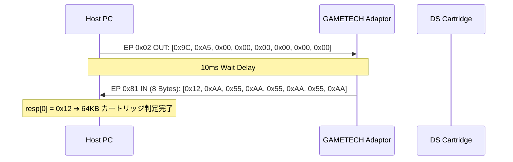
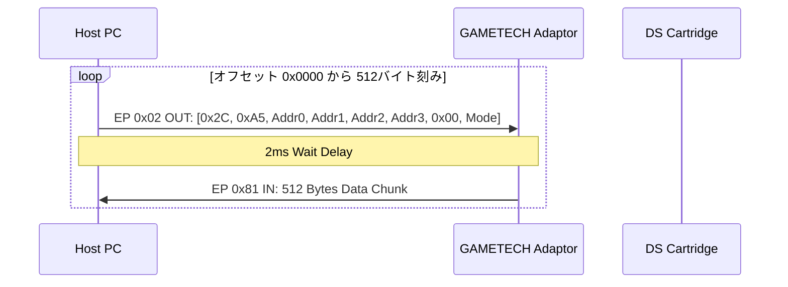
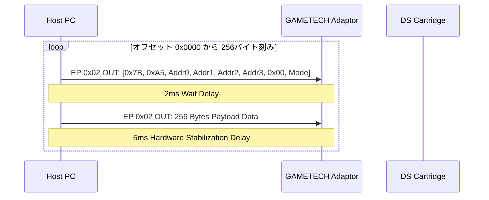

# 📡 GAMETECH NDS Adaptor（「セーブデータやりくり上手」）USBプロトコル詳細仕様書

---

## 1. ハードウェア＆デバイス概要

| 項目 | 値 / 仕様 |
| :--- | :--- |
| **製品名** | GAMETECH セーブデータやりくり上手 (NDS Adaptor OEM by EMS Production) |
| **Vendor ID (VID)** | `0x4670` (EMS Production Ltd.) |
| **Product ID (PID)** | `0xE6E9` (GT Inter-Link / NDS Adaptor non-Plus) |
| **USB インターフェース** | Interface 0, Alternate Setting 0 |
| **エンドポイント OUT** | **`EP 0x02`** (BULK OUT, MaxPacketSize: 64 Bytes) |
| **エンドポイント IN** | **`EP 0x81`** (BULK IN, MaxPacketSize: 64 Bytes) |

> [!IMPORTANT]
> 本製品 (`PID: 0xE6E9`) は NDS Adaptor Plus (`PID: 0x9394`) とはプロトコルが全く異なります。  
> 魔法ヘッダーとして `'G' 'T'` (`0x47 0x54`) ではなく、**`0xA5` シリーズのマジックバイト** を使用し、アドレス指定は **32ビット Little-Endian** で行います。

---

## 2. コマンドパケット構造 (8 Bytes)

すべての読み出し・書き込み・クエリ命令は、**8バイト固定長** のコマンドパケットを `EP 0x02` OUT エンドポイントに送信することで開始されます。

### 8バイトコマンドパケットフォーマット
```
+--------+--------+--------+--------+--------+--------+--------+--------+
| Byte 0 | Byte 1 | Byte 2 | Byte 3 | Byte 4 | Byte 5 | Byte 6 | Byte 7 |
+--------+--------+--------+--------+--------+--------+--------+--------+
|   Opcode Low    |      32-Bit Address (Little-Endian)   | 0x00   |  Mode  |
+-----------------+---------------------------------------+--------+--------+
```

| バイト位置 | フィールド名 | 説明 |
| :--- | :--- | :--- |
| **Byte 0** | Opcode Low | 操作コードのローバイト (例: `0x2C`, `0x9C`, `0x7B`) |
| **Byte 1** | Opcode High | 操作コードのハイバイト (固定値: **`0xA5`**) |
| **Byte 2** | Address Byte 0 | オフセットアドレス bits 0..7 (Little-Endian) |
| **Byte 3** | Address Byte 1 | オフセットアドレス bits 8..15 (Little-Endian) |
| **Byte 4** | Address Byte 2 | オフセットアドレス bits 16..23 (Little-Endian) |
| **Byte 5** | Address Byte 3 | オフセットアドレス bits 24..31 (Little-Endian) |
| **Byte 6** | Sub-Param | 予約バイト (基本固定値: `0x00`) |
| **Byte 7** | Mode Byte | カートリッジ EEPROM / Flash モード識別値 (例: `0x12`) |

---

## 3. 操作コード (Opcode) 一覧

| オペコード (Hex) | 16ビット値 (LE) | 命令の役割 | 送信バッファサイズ | 返却/受信バッファ |
| :--- | :--- | :--- | :--- | :--- |
| **`0x9C 0xA5`** | `0xA59C` | **Autodetect Query** (カートリッジ認識・モード判定) | 8 Bytes (`EP 0x02`) | 8 Bytes (`EP 0x81`) |
| **`0x2C 0xA5`** | `0xA52C` | **Sector Read** (セクター読み出し命令) | 8 Bytes (`EP 0x02`) | 512 Bytes (`EP 0x81`) |
| **`0x7B 0xA5`** | `0xA57B` | **Sector Write** (セクター書き込み命令) | 8 Bytes (`EP 0x02`) + Payload | ACK / レスポンスなし |

---

## 4. セーブ容量とモードバイト (`Byte 7`) 対応表

公式アプリ（`やりくり.exe`）のデコンパイル解析により判明した容量と `Mode Byte` の全対応表です。

| セーブ容量 | セーブ種別 | モードバイト (`Byte 7`) | 全バイト数 | ブロック数 (512B) |
| :--- | :--- | :--- | :--- | :--- |
| **512 Bytes** | 4 Kbit EEPROM | `0x01` | 512 Bytes | 1 ブロック |
| **8 KB** | 64 Kbit EEPROM | `0x02` | 8,192 Bytes | 16 ブロック |
| **64 KB** | **512 Kbit EEPROM (DQ9, メタルマックス3等)** | **`0x12`** (Mode 0x12) | **65,536 Bytes** | **128 ブロック** |
| **256 KB** | 2 Mbit Flash/EEPROM | `0x03` | 262,144 Bytes | 512 ブロック |
| **512 KB** | 4 Mbit Flash | `0x13` | 524,288 Bytes | 1,024 ブロック |
| **1 MB** | 8 Mbit Flash | `0x23` | 1,048,576 Bytes | 2,048 ブロック |

---

## 5. 通信シーケンスの詳細

### ① 自動判定シーケンス (Autodetect Query)


### ② 吸出しシーケンス (Sector Read Sequence)


### ③ 書き戻しシーケンス (Sector Write Sequence)

